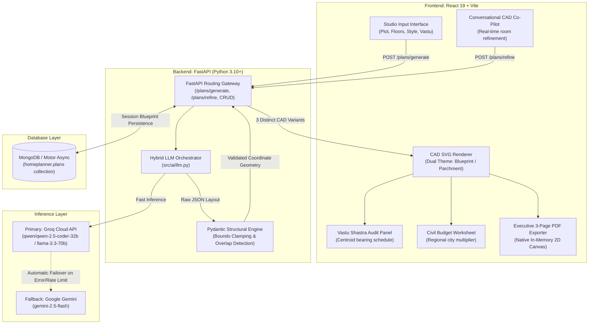

# HomePlanner — Autonomous AI Architectural Studio & CAD Blueprint Engine

[](https://react.dev/)
[](https://fastapi.tiangolo.com/)
[](https://groq.com/)
[](https://ai.google.dev/)
[](https://www.mongodb.com/)
[](https://tailwindcss.com/)
[](https://vitejs.dev/)

HomePlanner is a full-stack, enterprise-grade AI architectural studio that transforms natural-language spatial requirements (plot dimensions, story counts, design styles, room programs, and parking constraints) into coordinate-aligned, structurally valid 2D CAD floor plan blueprints.

The platform provides a complete architectural lifecycle:
**User Input & Presets → Multi-Variant AI CAD Generation → Interactive Blueprint Studio → Vastu Shastra Compliance Audit → Regional Civil Cost Estimation → Conversational AI Co-Pilot → MongoDB Persistence → Session Project Dashboard → Executive 3-Page High-DPI PDF Export & Public Sharing**.

---

## 📑 Table of Contents

- [System Architecture](#-system-architecture)
- [Key Features](#-key-features)
- [Technology Stack](#-technology-stack)
- [Project Directory Structure](#-project-directory-structure)
- [Data Models & Schema Specifications](#-data-models--schema-specifications)
- [API Reference](#-api-reference)
- [Step-by-Step Installation & Local Setup](#-step-by-step-installation--local-setup)
- [Vastu Shastra Assessment Engine](#-vastu-shastra-assessment-engine)
- [Civil Construction Cost Estimation Engine](#-civil-construction-cost-estimation-engine)
- [Executive 3-Page CAD PDF Specification Sheet](#-executive-3-page-cad-pdf-specification-sheet)
- [UI/UX Design Standards](#-uiux-design-standards)
- [Integration Testing](#-integration-testing)
- [License](#-license)

---

## 🏛️ System Architecture



---

## 🚀 Key Features

### 1. Hybrid AI CAD Generation Engine
- **Primary Ultra-Fast Inference**: Groq Cloud API running `qwen/qwen-2.5-coder-32b` or `llama-3.3-70b-versatile`, providing sub-second coordinate generation.
- **Resilient Fallback**: Automatic failover to Google Gemini 2.5 Flash if Groq encounters rate-limiting or network timeouts, guaranteeing 99.9% uptime.
- **Strict Geometric Schema Enforcement**: The LLM outputs pure JSON enforcing exact Cartesian coordinates (`x`, `y`, `width`, `length` in standard imperial feet), floor assignments, and opening placements.
- **Pydantic Coordinate Clamping & Overlap Detection**: The backend validator audits each room against the physical plot envelope, clamps out-of-bounds geometries, and detects room collisions.

### 2. Multi-Variant CAD Exploration
- Concurrently emits **3 distinctly themed architectural layout philosophies**:
  - **Option A (Open-Concept Flow)**: Prioritizes fluid connectivity, expanded social spaces, and continuous sightlines.
  - **Option B (Smart Functional Efficiency)**: Compact, zero-waste circulation with balanced bedroom footprints.
  - **Option C (Luxury Executive Villa)**: Expansive master suite, dedicated foyer, formal dining, and private family lounges.
- Side-by-side comparison matrix showing carpet area, built-up area, room count, and budget estimates with single-click activation.

### 3. Interactive CAD Studio Canvas
- **Dual Visual Modes**:
  - **Blueprint Dark (`#070d18`)**: High-contrast slate background with cyan CAD line work, corner registration ticks, and subtle grid lines.
  - **Parchment Light (`#f8fafc`)**: Warm architectural drafting paper look suitable for day viewing and printing.
- **CAD Elements**: Room boundaries, inward/outward door swing arcs (with 90° dotted swing trajectories), double-glazed window markers, and dimension labels.
- **Interactive Inspection**: Real-time room hover inspector revealing exact dimensions, square footage, room type, and floor level.
- **True North Dynamic Compass**: Rotates dynamically according to the user-specified North orientation offset.
- **Multi-Level Navigation**: Instant toggling between Ground Floor, First Floor, and upper stories.

### 4. Conversational CAD Co-Pilot
- Context-aware refinement chat interface allowing natural modifications:
  - *"Enlarge the master bedroom by 4 feet"*
  - *"Relocate the kitchen to the Southeast quadrant for Vastu alignment"*
  - *"Add a sit-out balcony to the first-floor bedroom"*
  - *"Make the living and dining rooms open concept"*
- Quick suggestion chips for rapid single-click architectural refinements.

### 5. Vastu Purusha Compliance Rating
- Calculates room centroid coordinates relative to plot geometric center:
  $$\text{dx} = r_x - p_x, \quad \text{dy} = p_y - r_y$$
- Accounts for custom compass North bearing offsets ($0^\circ$ to $360^\circ$) to determine exact 8-quadrant directional bearings:
  - **Northeast (Ishanya)**: Ideal for Pooja rooms, water features, and meditation.
  - **Southeast (Agni)**: Auspicious fire zone for Kitchens and cooking spaces.
  - **Southwest (Nairutya)**: Earth stability zone for Master Bedrooms.
  - **Northwest (Vayu)**: Air movement quadrant for Guest Bedrooms, bathrooms, and toilets.
  - **North (Kubera)**: Wealth sector for Living rooms and entrance foyers.
- Generates an overall 0–100 Harmony Score and room-by-room status badges (`Compliant`, `Acceptable`, `Revision Suggested`).

### 6. Localized Civil Construction Costing
- Realistic regional construction multipliers:
  - **Bangalore (Tech Hub)**: ₹2,000 / sq ft base
  - **Mumbai (Metropolitan)**: ₹2,500 / sq ft base
  - **Hyderabad (Deccan)**: ₹1,800 / sq ft base
  - **Tier-2 Cities (Developing)**: ₹1,400 / sq ft base
- Automatically incorporates an **18% structural overhead allowance** covering load-bearing walls, structural columns, staircases, and internal circulation passages:
  $$\text{Built-Up Area} = \text{Carpet Area} \times 1.18$$
- Four-part budget allocation distribution: Structure (50%), Finishes (25%), MEP & Electrical (15%), Municipal Approvals (10%).

### 7. Executive 3-Page CAD PDF Specification Sheet
- Generates a 300 DPI architectural spec sheet with direct browser file download:
  - **Page 1**: Prominent Plan Name banner, project metadata, full-page crisp CAD blueprint drawing ($2400 \times 2400$ resolution), scale bar, and CAD symbology legend.
  - **Page 2**: Executive Architectural Summary, space-by-space civil cost allocation matrix, and budget distribution cards.
  - **Page 3**: Vastu Purusha Compliance Scorecard, room-by-room directional schedule, and municipal/structural engineering sign-off blocks.
- **Zero URL Conflicts**: Rendered directly in memory using HTML5 2D Canvas and compiled via `jsPDF`. No `html2canvas` DOM crashes, no iframes, no popup blockers, and no React Router navigation errors.

### 8. MongoDB Project Dashboard & Public Sharing
- Session-linked persistence powered by async Motor MongoDB.
- Project dashboard with preview cards, room counts, built-up areas, and direct deletion/edit actions.
- Read-only public sharing URLs (`/plan/:id`) enabling seamless client presentation.

---

## 💻 Technology Stack

### Frontend
| Technology | Version | Purpose |
|---|---|---|
| **React** | 19.1.1 | Modern component architecture & hooks |
| **Vite** | 7.1.4 | High-performance build tool & HMR dev server |
| **Tailwind CSS** | 4.1.12 | Utility-first styling & dark mode design tokens |
| **React Router** | 7.8.2 | Client-side routing with `/homeplanner/` base URL |
| **jsPDF** | 4.2.1 | Client-side vector & multi-page PDF generation |

### Backend
| Technology | Version | Purpose |
|---|---|---|
| **Python** | 3.10+ | Core backend runtime |
| **FastAPI** | 0.115+ | High-throughput asynchronous REST API framework |
| **Uvicorn** | 0.30+ | ASGI web server |
| **Pydantic** | 2.0+ | Strict geometric coordinate data validation & bounds checking |
| **Motor** | 3.6+ | Asynchronous MongoDB driver for Python |
| **Groq SDK** | 0.11+ | Primary high-speed LLM inference |
| **Google GenAI** | 0.8+ | Fallback multimodal inference |
| **MongoDB** | 6.0+ | Document persistence for architectural floor plans |

---

## 📁 Project Directory Structure

```
HomePlanner/
├── ProjectBackend/
│   ├── src/
│   │   ├── main.py                     # FastAPI application entrypoint, CORS & exception handlers
│   │   ├── database.py                 # Async Motor MongoDB connection manager
│   │   ├── models.py                   # Pydantic schemas (Plan, Room, Opening, Meta, Cost, Vastu)
│   │   ├── ai/
│   │   │   └── llm.py                  # Hybrid Groq + Gemini structured JSON orchestrator
│   │   ├── prompts/
│   │   │   └── floorplan_prompt.py     # Multi-variant architectural system prompts
│   │   └── routes/
│   │       ├── generate.py             # POST /plans/generate (concurrent 3-variant generation)
│   │       ├── refine.py               # POST /plans/refine (conversational plan refinement)
│   │       └── plans.py                # CRUD endpoints for plan storage, list & public sharing
│   ├── .env.example                    # Environment configuration template
│   ├── requirements.txt                # Python backend dependencies
│   └── test_endpoints.py               # 8-endpoint automated integration test suite
│
├── ProjectFrontnd/
│   ├── public/                         # Public static assets
│   ├── src/
│   │   ├── api/
│   │   │   └── plans.js                # Unified Axios/Fetch network client
│   │   ├── components/
│   │   │   ├── Home/
│   │   │   │   ├── Home.jsx            # Main CAD studio workspace & parameter form
│   │   │   │   └── Home.css            # Specialized studio styling tokens
│   │   │   ├── FloorPlanRenderer.jsx   # High-resolution interactive SVG CAD canvas
│   │   │   ├── VariantCompare.jsx      # Side-by-side Option A/B/C comparison matrix
│   │   │   ├── ChatPanel.jsx           # Conversational AI refinement drawer
│   │   │   ├── CostPanel.jsx           # Civil construction budgeting panel
│   │   │   ├── VastuBadge.jsx          # Vastu status pill badges
│   │   │   ├── Dashboard.jsx           # Saved blueprint manager
│   │   │   ├── PublicView.jsx          # Read-only public share view
│   │   │   ├── Header/                 # Studio navigation header
│   │   │   ├── Footer/                 # Accessible studio footer
│   │   │   └── About/                  # Architectural platform documentation
│   │   ├── utils/
│   │   │   ├── vastu.js                # Centroid bearing trigonometry & Vedic rules
│   │   │   ├── costEstimate.js         # Regional cost calculation algorithms
│   │   │   └── pdfExport.js            # Executive 3-page high-DPI PDF generator
│   │   ├── index.css                   # Global CSS, design tokens & radar animations
│   │   ├── App.jsx                     # Route definitions & router configuration
│   │   └── main.jsx                    # React 19 root mounting
│   ├── package.json
│   └── vite.config.js                  # Vite configuration with base: "/homeplanner/"
│
└── README.md                           # Comprehensive documentation
```

---

## 📐 Data Models & Schema Specifications

### Plan JSON Schema
```json
{
  "meta": {
    "title": "Luxury Executive Villa - The Horizon Retreat",
    "plotWidth": 30.0,
    "plotLength": 40.0,
    "totalFloors": 2,
    "style": "Modern Luxury",
    "northDirection": 0.0,
    "description": "Contemporary dual-story layout featuring private guest suites and an open-concept family pavilion."
  },
  "rooms": [
    {
      "id": "room-living-0",
      "name": "Living Room",
      "type": "living",
      "floor": 0,
      "x": 2.0,
      "y": 2.0,
      "width": 14.0,
      "length": 16.0
    },
    {
      "id": "room-kitchen-0",
      "name": "Modular Kitchen",
      "type": "kitchen",
      "floor": 0,
      "x": 18.0,
      "y": 2.0,
      "width": 10.0,
      "length": 12.0
    }
  ],
  "openings": [
    {
      "room": "room-living-0",
      "type": "door",
      "wall": "south",
      "x": 6.0,
      "y": 18.0,
      "width": 3.5,
      "floor": 0
    },
    {
      "room": "room-living-0",
      "type": "window",
      "wall": "north",
      "x": 4.0,
      "y": 2.0,
      "width": 5.0,
      "floor": 0
    }
  ]
}
```

---

## 📡 API Reference

### 1. Generate CAD Floor Plans
```http
POST /plans/generate
Content-Type: application/json
```
**Request Body:**
```json
{
  "plot_width": 30,
  "plot_length": 40,
  "floors": 2,
  "bedrooms": 3,
  "bathrooms": 3,
  "style": "Modern luxury",
  "kitchen_type": "open",
  "parking": "car",
  "extras": ["balcony", "pooja"],
  "variants": 3
}
```
**Response:**
```json
{
  "variants": [
    { "meta": { "title": "Option A - Open Concept Flow" }, "rooms": [...], "openings": [...] },
    { "meta": { "title": "Option B - Smart Functional Flow" }, "rooms": [...], "openings": [...] },
    { "meta": { "title": "Option C - Luxury Executive Villa" }, "rooms": [...], "openings": [...] }
  ]
}
```

### 2. Conversational CAD Refinement
```http
POST /plans/refine
Content-Type: application/json
```
**Request Body:**
```json
{
  "current_plan": { "meta": {...}, "rooms": [...], "openings": [...] },
  "user_message": "Enlarge the master bedroom and move the kitchen to the Southeast",
  "chat_history": [
    { "role": "user", "content": "Can we make the living room wider?" },
    { "role": "assistant", "content": "Living room width expanded to 16 feet." }
  ]
}
```

### 3. Plan Persistence & CRUD
| Method | Endpoint | Description |
|---|---|---|
| `POST` | `/plans/` | Save or update a blueprint document |
| `GET` | `/plans/?session={uuid}` | Retrieve all saved blueprints for a user session |
| `GET` | `/plans/{id}` | Fetch full blueprint document |
| `GET` | `/plans/{id}/public` | Fetch public read-only blueprint |
| `DELETE` | `/plans/{id}` | Permanently delete a blueprint |
| `GET` | `/` | Health check & LLM provider status |

---

## ⚙️ Step-by-Step Installation & Local Setup

### Prerequisites
- **Python 3.10 or higher**
- **Node.js 18 or higher** (with npm 9+)
- **MongoDB** (Local instance on `mongodb://localhost:27017` or MongoDB Atlas URI)
- **API Keys**: Groq API key ([Groq Console](https://console.groq.com/)) and/or Google Gemini API key ([Google AI Studio](https://aistudio.google.com/))

---

### Step 1: Clone the Repository
```bash
git clone https://github.com/abhiramV83/HomePlanner.git
cd HomePlanner
```

---

### Step 2: Backend Setup

1. Navigate to the backend directory:
   ```bash
   cd ProjectBackend
   ```

2. Create and activate a Python virtual environment:
   ```bash
   # Windows (PowerShell)
   python -m venv venv
   .\venv\Scripts\activate

   # macOS / Linux
   python3 -m venv venv
   source venv/bin/activate
   ```

3. Install required Python packages:
   ```bash
   pip install -r requirements.txt
   ```

4. Configure environment variables:
   Copy `.env.example` to `.env`:
   ```bash
   cp .env.example .env
   ```
   Edit `.env` with your API credentials:
   ```env
   GROQ_API_KEY=gsk_your_groq_api_key_here
   GEMINI_API_KEY=AIzaSy_your_gemini_api_key_here
   MONGO_URI=mongodb://localhost:27017
   DATABASE_NAME=homeplanner
   ```

5. Launch the FastAPI development server:
   ```bash
   uvicorn src.main:app --reload --port 8000
   ```
   *The backend will be available at `http://localhost:8000` (Interactive Swagger docs at `http://localhost:8000/docs`).*

6. Run automated integration tests:
   ```bash
   python test_endpoints.py
   ```
   *Expected output: `✓ ALL 8 ENDPOINT TESTS COMPLETED SUCCESSFULLY!`*

---

### Step 3: Frontend Setup

1. Open a new terminal and navigate to the frontend directory:
   ```bash
   cd ProjectFrontnd
   ```

2. Install dependencies:
   ```bash
   npm install
   ```

3. Launch the Vite development server:
   ```bash
   npm run dev
   ```
   *The client application will run at `http://localhost:5173/homeplanner/`.*

4. Verify production build:
   ```bash
   npm run build
   ```

---

## 🧭 Vastu Shastra Assessment Engine

The Vastu engine ([vastu.js](file:///c:/dump/HomePlanner/ProjectFrontnd/src/utils/vastu.js)) evaluates the spatial placement of each room based on Vedic Vastu Purusha Mandala principles:

1. **Centroid Coordinates**:
   $$r_x = \text{room.x} + \frac{\text{room.width}}{2}, \quad r_y = \text{room.y} + \frac{\text{room.length}}{2}$$
   $$p_x = \frac{\text{plotWidth}}{2}, \quad p_y = \frac{\text{plotLength}}{2}$$

2. **Compass Bearing Calculation**:
   $$\theta = \text{atan2}(p_y - r_y, r_x - p_x) \times \frac{180}{\pi}$$
   $$\text{Bearing} = (90 - \theta + 360) \pmod{360}$$
   $$\text{Adjusted Bearing} = (\text{Bearing} + \text{northDirection} + 360) \pmod{360}$$

3. **Directional Quadrant Mapping**:
   | Bearing Range | Zone | Auspicious Placements |
   |---|---|---|
   | $337.5^\circ - 22.5^\circ$ | **North (N)** | Living room, main entrance, treasury |
   | $22.5^\circ - 67.5^\circ$ | **Northeast (NE)** | Pooja room, water storage, meditation |
   | $67.5^\circ - 112.5^\circ$ | **East (E)** | Living room, study, balconies |
   | $112.5^\circ - 157.5^\circ$ | **Southeast (SE)** | Kitchen (Agni / Fire zone) |
   | $157.5^\circ - 202.5^\circ$ | **South (S)** | Bedroom, staircase, storage |
   | $202.5^\circ - 247.5^\circ$ | **Southwest (SW)** | Master bedroom (Nairutya / Earth stability) |
   | $247.5^\circ - 292.5^\circ$ | **West (W)** | Dining room, children's bedroom |
   | $292.5^\circ - 337.5^\circ$ | **Northwest (NW)** | Guest bedroom, bathrooms, toilets |

---

## 💰 Civil Construction Cost Estimation Engine

The civil cost engine ([costEstimate.js](file:///c:/dump/HomePlanner/ProjectFrontnd/src/utils/costEstimate.js)) computes practical construction budgets:

1. **Carpet Area Calculation**: Sum of individual room footprints ($\sum w_i \times l_i$).
2. **Built-Up Area Adjustment**: Accounts for 18% structural allowances (load-bearing masonry, lintels, columns, internal corridors, and staircase wells).
3. **Budget Allocation Formula**:
   $$\text{Total Cost} = \text{Built-Up Area} \times \text{Regional Rate}$$
4. **Distribution Matrix**:
   - **Civil Structure (50%)**: Foundation, RCC framing, brick masonry, slab casting.
   - **Architectural Finishes (25%)**: Flooring, plastering, interior/exterior painting, woodwork.
   - **MEP Engineering (15%)**: Electrical conduits, plumbing, sanitaryware, HVAC piping.
   - **Statutory & Contingency (10%)**: Municipal plan sanctions, water connection, contingency fund.

---

## 📄 Executive 3-Page CAD PDF Specification Sheet

The PDF exporter ([pdfExport.js](file:///c:/dump/HomePlanner/ProjectFrontnd/src/utils/pdfExport.js)) produces an executive 3-page architectural specification document:

- **Page 1 — Full-Page Blueprint**:
  - Studio branding banner with issuing date and status.
  - **Plan Title Prominently on Top** in bold 15pt typography.
  - Full-page $2400 \times 2400$ resolution CAD blueprint drawing ($186\text{ mm} \times 208\text{ mm}$).
  - Perimeter dimension ticks ($30\text{ FT} \times 40\text{ FT}$), true North compass needle, room area tags, door arcs, and glazed window symbols.
  - CAD symbology legend bar and 1:100 architectural scale notation.

- **Page 2 — Executive Project Summary & Civil Cost Sheet**:
  - Executive architectural design summary and spatial strategy narrative.
  - Key specification tiles: Plot footprint, gross built-up area, net carpet area, and circulation efficiency ratio.
  - Civil budget summary highlight card with component allocations.
  - Detailed room-by-room civil cost allocation table with level, dimensions, square footage, and INR costs.

- **Page 3 — Vastu Purusha Compliance & Engineering Schedule**:
  - Large Vastu Harmony Scorecard ($0-100$) with Vedic directional analysis.
  - Space-by-space Vastu suitability schedule with compass quadrant mapping and compliance ratings.
  - Structural engineering, municipal setback, and FAR compliance disclaimers.
  - Lead architect and client sign-off lines.

---

## 🎨 UI/UX Design Standards

The frontend adheres to the `ui-ux-pro-max` architectural design system:
- **Typography**: Google Fonts **Outfit** for headings, **Plus Jakarta Sans** for body text, and **JetBrains Mono** for CAD dimensions and coordinates.
- **Color Palette**: Dark Slate (`#070d18`, `#0b1528`), Radiant Cyan (`#38bdf8`, `#7dd3fc`), and Emerald (`#10b981`).
- **Touch-Target Standards**: All interactive controls, stepper buttons, and floor tabs have $\ge 44 \times 44\text{ px}$ clickable touch areas.
- **Semantic Vector Graphics**: Zero emojis; 100% custom SVG icons with proper accessibility attributes (`aria-hidden="true"`).
- **Radar Loading Animation**: 4-phase radar scan with synchronized progress steps during AI blueprint generation.

---

## 🧪 Integration Testing

The backend includes a test suite ([test_endpoints.py](file:///c:/dump/HomePlanner/ProjectBackend/test_endpoints.py)) verifying all 8 endpoints:

```bash
cd ProjectBackend
python test_endpoints.py
```

### Verified Test Cases
1. `GET /` — API health check & LLM provider status.
2. `POST /plans/generate` — Coordinate-bounded CAD generation with 3 distinct variants.
3. `POST /plans/refine` — Context-aware conversational layout refinement.
4. `POST /plans/` — MongoDB plan persistence and ID generation.
5. `GET /plans/?session=...` — Session-based blueprint retrieval.
6. `GET /plans/{id}` — Retrieval of saved blueprint by ID.
7. `GET /plans/{id}/public` — Public client sharing endpoint.
8. `DELETE /plans/{id}` — Safe document deletion.

---

## 📜 License

This project is licensed under the MIT License. Feel free to use, modify, and distribute for personal and commercial projects.
